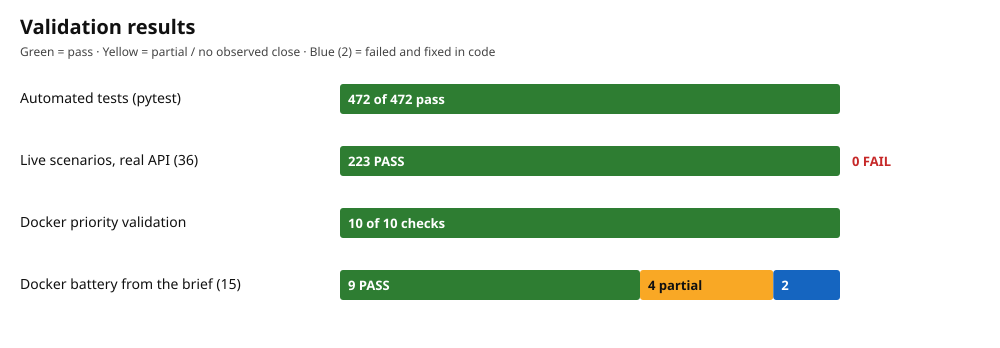

# Nuva Living — Maintenance Visit Scheduling Agent

A CLI agent that coordinates maintenance visits between tenants and a single handyman. It reads work orders from a CSV, communicates over stdin/stdout, and ends each negotiation with `scheduled` or `requires_review`. Visits last 2 hours, use `Europe/Madrid`, and require both parties to explicitly accept the same date and time.

## Running

Requirement: **Docker**. Create a `.env` with `ANTHROPIC_API_KEY` (template in [.env.example](.env.example)) and do not commit it to the repository. The `Dockerfile` is in the root.

```bash
mkdir -p traces
docker build -t agent .
docker run --env-file .env -i \
  -v "$(pwd)/work_orders.csv:/app/work_orders.csv:ro" \
  -v "$(pwd)/traces:/app/traces" \
  agent
```

- To try the sample, mount `examples/work_orders.csv` instead of `work_orders.csv`.
- On Linux, if the traces end up owned by `root`, add `--user "$(id -u):$(id -g)"`.

## Protocol

CSV input (read-only): `work_order_id,work_order,address,description,reported_at,urgency`, with `urgency` as `Critical`, `High`, `Medium` or `Low`.

**Startup:** on start, the agent sends the first message for every work order in the CSV without waiting for replies. It then accepts messages for any unfinished order, in any order.

Outgoing message (stdout), terminated by a blank line:

```text
WOID:WO-002|ROLE:handyman
Can you do the visit tomorrow, October 8, at 16:00?

```

Incoming message (stdin):

```text
WO-002|tenant Tomorrow after 17:00 works for me.
```

Final results (illustrative examples of the format; actual output is in `examples/docker-run-scheduled/`):

```text
WOID:WO-002|RESULT:scheduled
SCHEDULED_FOR:2026-10-08T18:00:00+02:00

WOID:WO-003|RESULT:requires_review
REASON:Unable to establish a mutually acceptable visit time.
```

The console only shows the protocol; traces and logs go to `/app/traces`.

## Scheduling rules

- One handyman. Each visit lasts 2 hours and visits do not overlap.
- `scheduled` only if the tenant and the handyman both explicitly accept the same date and time. Both receive a confirmation before the result.
- If they compete for the same availability, the higher urgency wins: `Critical > High > Medium > Low`.
- The handyman is written to in Spanish; the tenant, in the language of their order.
- Dates and times are in `Europe/Madrid`, without ambiguity.
- `<NO RESPONSE>` is a timeout: the order ends as `requires_review`. No real-time waits are used.
- If coordination cannot be done reliably, `requires_review` with a short reason.

## Decisions

Details and rationale in [decisions and extensions](docs/decisions-tradeoffs.md).

### Business

1. **Horizon:** dates up to today plus 7 days, inclusive. In production, the window would be full calendar weeks.
2. **Invalid intervals:** rejected as sent; never trimmed.
3. **Back-to-back visits:** 14:00–16:00 and 16:00–18:00 are compatible. Travel time and preparation are not modeled.
4. **Query order:** the tenant first, to confirm their availability; then the handyman.
5. **Full intervals:** all available intervals are requested, to have alternatives if one slot does not work.
6. **Interval merging:** overlapping or contiguous intervals are joined (10:00–11:00 + 11:00–12:00 allow a 2-hour visit).
7. **2-hour candidates:** generated from the start the tenant gave (10:00–15:00 → 10:00–12:00 and 12:00–14:00).
8. **Conflicts before the handyman:** candidates blocked by an appointment or a reservation of equal or higher urgency are discarded before asking the handyman.
9. **Urgency during open negotiation:** a `Critical` order can take a tentative reservation from a `Low` order if its tenant accepts. The transfer is atomic.
10. **Simultaneous offers:** two negotiations can offer the same slot; the competition is resolved at booking time. Confirmed appointments are not moved.
11. **Displaced tenant:** they are notified and receive an alternative or a request for availability. Their time is never reassigned silently.
12. **No options:** the tenant is asked whether they want human coordination. If they accept, `requires_review`; if they decline, they are asked for new availability.
13. **Review reasons:** `no_response`, `no_common_availability` or `no_eligible_slot`, with the known facts. Unknown things are stated as unknown.

### Technical

1. **Yes/no in code:** replies are interpreted with a closed list of variants (ES/EN, with or without accents). Any other reply is asked again; the model does not decide.
2. **Errors separated from silence:** an Anthropic failure is recorded as a technical incident; it never counts as a participant's silence.
3. **Per-run traces:** messages, states and decisions are stored as JSONL. stdout and stderr are reserved for the protocol.
4. **Configuration once:** configuration and dependencies are loaded at startup; changes require a restart.
5. **Injection guard:** an LLM classifier flags suspicious messages; the code removes the fragment and, if nothing valid remains, blocks. On provider errors it fails open, and the later validation stays active.
6. **Silence retries (disabled):** if enabled, they wait using real UTC time. This contradicts the brief, so the default is `false` and the order closes immediately.

## Evaluation criteria

| Criterion | Covered in |
|---|---|
| Correct result per order | [Architecture](docs/architecture-negotiation.md#negotiation-flow) |
| Clear communication and dates | [Protocol](#protocol) |
| Explicit agreement, no overlaps | [Rules](#scheduling-rules) |
| Robustness (silence, contradictions, injection) | [Architecture](docs/architecture-negotiation.md#participant-silence-no-response) |
| Use of `requires_review` | [Business decisions](#business) |
| Code, state and errors | [Architecture](docs/architecture-negotiation.md) |
| Traces to reconstruct the coordination | [Traces and tests](docs/traces-and-tests.md#traces) |

## Traces and tests

Each run creates `traces/runs/<timestamp>-<run_id>/` with `manifest.jsonl`, `events.jsonl` and `runtime.jsonl`. Each event includes `timestamp`, `work_order_id`, `event_type` and `detail`.

Versioned examples:

- [`examples/docker-run-scheduled/`](examples/docker-run-scheduled/): run with the Docker image and the sample CSV. WO-001 (`Critical`) ends `scheduled` at 16:00; WO-002 (`High`) ends `requires_review` because the slot is taken by the more urgent order. Includes input, output and traces.
- [`examples/complete-run/`](examples/complete-run/runs/20261012T170800+02:00-657314e2/): earlier live run with the same CSV.

```bash
uv run pytest
```

More detail in [traces and tests](docs/traces-and-tests.md), including the live evaluator ([tests/live](tests/live/README.md)).

## Validation

The runs in this section use the model `claude-haiku-5-5` and the Docker image `agent`, rebuilt from the working tree.



| Layer | What it checks | Result |
|---|---|---|
| Automated tests (`uv run pytest`) | Domain rules, negotiation flows, settings, retry queue, CLI protocol | **472 of 472 pass** |
| Live scenarios ([tests/live](tests/live/README.md)) | 36 conversations with fixed inputs against the real API: dates, ambiguity, confirmations, injection, priority, cancellations | **223 PASS, 0 FAIL** |
| Docker priority validation ([validation/priority-renegotiation](validation/priority-renegotiation/README.md)) | 8 mixed orders with urgency preemption, run as an evaluator would (`docker run -i`) | **10 of 10 automated checks** |
| Docker battery based on the brief | 15 cases derived from `docs/take-home-test.pdf` | 9 PASS, 4 partial, 2 fixed (see below) |

### Key results

- **Startup:** 6 mixed orders get their first message in 6–14 s, without waiting for replies.
- **Scheduled visits:** full negotiation in English and Spanish to `scheduled`, confirmed to both sides, one final result per order.
- **Six orders at once:** 5 finished in 62 s with no overlapping visits; 1 `requires_review` (`<NO RESPONSE>`). The sixth was still renegotiating when the script ended, so that run is inconclusive.
- **Priority:** 8 orders, 2 preemptions from higher to lower urgency, **no overlapping visits**.
- **Handyman always in Spanish:** 23 of 23 messages.
- **`<NO RESPONSE>`:** closes as `requires_review` in 6–45 ms, with no real wait. Retries are opt-in.
- **Security:** prompt injections are blocked or cleaned without booking anything; malformed input gets fixed replies.
- **Traces:** a scheduled order can be reconstructed end to end; no API keys in the reviewed traces.

Full detail (invariant checks, priority metrics, battery findings, how to reproduce, known limitations): [priority validation](validation/priority-renegotiation/README.md) and [traces and tests](docs/traces-and-tests.md).

## Stack

Python 3.12, LangGraph, Anthropic, Pydantic, `dependency-injector` and `uv`. Dependencies in [pyproject.toml](pyproject.toml) and `uv.lock`.

## Documentation

- [Architecture and negotiation](docs/architecture-negotiation.md)
- [Decisions and extensions](docs/decisions-tradeoffs.md)
- [Traces and tests](docs/traces-and-tests.md)
- [Configuration](docs/configuration.md) and [development](docs/development.md)
- [Original brief](docs/take-home-test.pdf)
