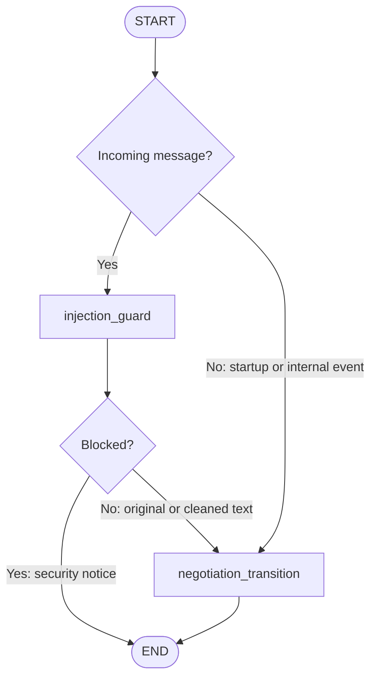
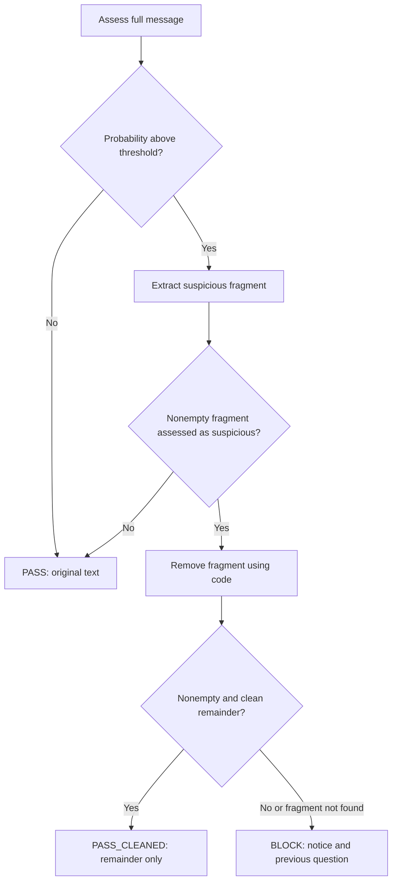

# Nuva Living — Maintenance Scheduling Agent

A CLI agent that coordinates maintenance visits between tenants and a single
handyman. It reads work orders from CSV, communicates through stdin/stdout, and
ends each negotiation with `scheduled` or `requires_review`. Visits last two
hours, use `Europe/Madrid`, and require both participants to explicitly accept
the same date and time.

## Running the agent

Docker is the evaluator's only prerequisite. Create `.env` with
`ANTHROPIC_API_KEY` (see [.env.example](.env.example)); never commit credentials.
Place `work_orders.csv` in the repository root and run:

```bash
mkdir -p traces
docker build -t agent .
docker run --env-file .env -i \
  -v "$(pwd)/work_orders.csv:/app/work_orders.csv:ro" \
  -v "$(pwd)/traces:/app/traces" \
  agent
```

Dependencies and development tools are declared in [pyproject.toml](pyproject.toml).
The container uses `uv.lock` to install reproducible versions. Settings are read
at startup; changing them requires a restart. Language recognition and
conversation models can be configured separately. Without credentials, the
fallback requests clarification instead of interpreting availability through
Anthropic.

## Communication protocol

The read-only CSV contains these columns. The repository's current sample has
one Critical work order in English and one High work order in Spanish:

```csv
work_order_id,work_order,address,description,reported_at,urgency
WO-001,Gas leak - 24 Oak Street,24 Oak Street,Tenant reports a strong smell of gas in the kitchen,2026-10-07T09:15:00+02:00,Critical
WO-002,Fuga de agua - Calle Mayor 18,Calle Mayor 18,El inquilino informa de una fuga de agua debajo del fregadero,2026-10-07T10:40:00+02:00,High
```

Incoming messages identify the work order and sender:

```text
WO-001|tenant I am available on 14 October 2026 from 16:00 to 18:00, Madrid time.
WO-002|tenant <NO RESPONSE>
```

Outgoing messages identify the recipient and end with a blank line:

```text
WOID:WO-001|ROLE:handyman
¿Puedes realizar la visita el 14 de octubre de 2026 de 16:00 a 18:00, hora de Madrid?

```

The terminal result formats are:

```text
WOID:WO-001|RESULT:scheduled
SCHEDULED_FOR:2026-10-14T16:00:00+02:00

WOID:WO-002|RESULT:requires_review
REASON:Unable to establish a mutually acceptable visit time.
```

These protocol examples illustrate the format. The handyman receives Spanish
messages; the tenant's language is inferred from the work-order description.
The console is reserved for the protocol; technical logs go to files.

## Business decisions

1. **A simplified planning horizon.** This take-home considers dates through
   today plus seven days, inclusive, to keep planning simple. In a real
   deployment, the planning window would be organized around complete calendar
   weeks. The agent communicates its current limit instead of offering dates
   beyond it.

2. **Reject invalid intervals without trimming them.** An interval outside the
   permitted hours or horizon is rejected as submitted. Automatically shortening
   it would change what the participant actually said they could accept.

3. **Allow consecutive visits without a buffer.** We assume the handyman can
   finish one slot and immediately start another: 14:00–16:00 and 16:00–18:00
   are compatible. Travel time and preparation time are not included in this
   scheduling model.

4. **Ask the tenant first.** Establishing the household's availability before
   consulting the handyman avoids negotiating visits the tenant cannot attend.

5. **Request all available intervals.** Collecting the full set gives the agent
   alternatives if a slot is occupied or unsuitable for the handyman, reducing
   repeated questions.

6. **Merge overlapping and adjacent availability.** This removes duplicates and
   preserves usable continuous windows. For example, 10:00–11:00 and 11:00–12:00
   together allow a full two-hour visit, although neither interval does alone.

7. **Generate two-hour candidates from the tenant's stated start.** Each candidate
   must fit the visit duration required by the assignment. Availability from
   10:00 to 15:00 produces 10:00–12:00 and 12:00–14:00; the final hour cannot
   accommodate a visit. Starting from the tenant's own interval avoids inventing
   a separate booking grid.

8. **Check conflicts before consulting the handyman.** Candidates blocked by a
   confirmed appointment or an equal- or higher-urgency tentative reservation
   are filtered out, avoiding questions about slots that cannot be assigned.

9. **Give higher urgency priority during an unfinished negotiation.** If a Low
   order has a tentative reservation and a Critical order needs the same time,
   the Critical order can take that reservation after its tenant explicitly
   accepts the proposed visit. The transfer is atomic and only succeeds if no
   equal- or higher-urgency reservation or confirmed appointment blocks it.
   This enforces the assignment's urgency rule while protecting visits already
   agreed with both parties.

10. **Allow simultaneous offers before reservation.** Two negotiations may offer
    the same currently free slot. Competition is resolved when acquiring the
    reservation. A lower-urgency order can keep it if it becomes a confirmed
    appointment first; confirmed visits are not displaced.

11. **Notify the tenant whose reservation was displaced.** The affected order
    continues with an explanation in the tenant's language and an eligible
    alternative, or a request for new availability. Its proposed time is never
    silently reassigned.

12. **Offer human coordination when options are exhausted.** Once complete
    evidence establishes that there is no common eligible visit, or known
    agenda conflicts exhaust the tenant's complete request, the agent asks
    whether the tenant wants human scheduling. Acceptance yields
    `requires_review`; declining leads to a request for new availability.

13. **Explain review outcomes from recorded evidence.** Reasons use
    `no_response`, `no_common_availability`, or `no_eligible_slot` and the known
    facts. Unknown availability is explicitly described as unknown, so the
    person taking over can understand what prevented scheduling.

## Technical decisions

1. **Interpret explicit confirmations with code.** Yes/no decisions are handled
   deterministically. Ambiguous answers trigger clarification rather than
   being converted into acceptance by the model.

2. **Separate provider failures from participant silence.** An Anthropic error
   is a technical incident recorded in the runtime trace. It does not mean a
   tenant or handyman failed to answer and is never converted into a human
   timeout.

3. **Keep structured traces for each execution.** Messages, state changes,
   decisions, and outcomes are correlated by run and work order. Separate
   manifest, event, and runtime files make the coordination reconstructable
   while keeping stdout and stderr reserved for the communication protocol.

4. **Read configuration and assemble dependencies once at startup.** Every
   conversation in a run uses consistent settings. Changes require restarting;
   dependencies are injected instead of being recreated or reconfigured inside
   graph nodes.

## Architecture and actual graph

The stack is Python 3.12, LangGraph, Anthropic, Pydantic, and
`dependency-injector`. The domain holds business rules; the application manages
negotiation and the shared agenda; infrastructure implements CSV, CLI, model
calls, and traces. Dependencies are assembled once at startup.

`AsyncCoordinator` starts all orders concurrently and retains a separate state
for each. A FIFO queue serializes events within each conversation. Different
orders progress concurrently against a single shared scheduling authority.

The compiled graph in [graph.py](src/maintenance_agent/agents/scheduling/graph.py)
executes **one transition per invocation**. With the security guard enabled, its
actual nodes and routing are:



`END` finishes that invocation. The coordinator delivers output, saves state,
and invokes the graph again for the next event. Without the guard, `START`
connects directly to `negotiation_transition`. The transition recognizes the
language once and dispatches startup, incoming messages, displaced reservations,
or continuation of final confirmations to the workflow.

## Negotiation workflow

The following phases run inside
[NegotiationWorkflow](src/maintenance_agent/application/workflow.py); they are
internal workflow steps rather than separate compiled graph nodes:


Availability creates candidates. Explicit acceptances refer to a specific
proposal ID and version. The tenant's acceptance triggers a reservation attempt;
the handyman's acceptance commits the appointment. Both participants receive
confirmation before the terminal result is emitted.

Agenda operations are atomic. A tentative reservation may be displaced by a
higher-urgency order (`Critical > High > Medium > Low`); confirmed appointments
are never displaced. The affected order receives an event to negotiate an
alternative. Priority is enforced when reservations are acquired: merely
offering a free slot does not reserve it.

Ambiguous replies prompt clarification. Availability changes are confirmed
before replacing earlier evidence. The exact body `<NO RESPONSE>` ends the
negotiation with `requires_review`, without real-time waiting. The workflow
stops advancing orders that already have a terminal status.

## Evaluators and validation

| Component | What it checks | Effect |
|---|---|---|
| LLM language recognizer | Work-order description language | Sets the tenant language; undetermined language uses bilingual text. |
| LLM availability interpreter | Intervals, mentioned dates, ambiguity, and vague requests | Returns typed evidence for validation. |
| LLM prompt-injection classifier | Message, suspicious fragment, and remainder | Supplies evidence for deterministic pass, clean, or block decisions. |
| LLM slot-reply validator | Language, clarity, invented dates, and technician availability claims | Accepts a draft or supplies regeneration feedback. |
| Deterministic validators | Inputs, dates, intervals, conflicts, and consent | Control accepted evidence and reservations. |

### Prompt-injection guard

The guard runs before message interpretation and is connected when Anthropic
credentials exist. The exact `<NO RESPONSE>` sentinel bypasses model screening.
The classifier returns `answer` and `probability_yes`; code applies
`probability_yes > INJECTION_THRESHOLD`, defaulting to `0.6`. This is a
self-reported model estimate, not a calibrated probability.



Screening uses up to three assessments plus one extraction call. Code removes
the fragment so the model does not rewrite the participant's message. A blocked
message does not advance negotiation or enter conversation history. Assessments
are traced. Provider errors make the guard fail open: the message continues,
the error is recorded, and downstream validation remains active.

### Slot-reply composer and evaluator

For vague requests, code builds an open-slot table from an agenda snapshot. The
LLM produces only an introduction and closing request. Code inserts the table
and the disclaimer that an open agenda slot does not establish handyman
availability.

Before delivery, deterministic checks require intact table content, both prose
sections, no internal identifiers, and an agenda that still matches the table.
A separate LLM call checks the language, the request for concrete dates, and
whether the prose invents times or promises technician availability.

Feedback is supplied to the next composition attempt, up to three attempts.
Malformed verdicts and provider errors count as failures. After exhaustion,
code sends a deterministic reply with the table and a clarification request.
This evaluator applies to slot suggestions; ordinary messages do not all pass
through an LLM evaluator.

### Tools and deterministic rules

The availability interpreter has tools for calendar calculations, visit end
times, date ranges, ambiguous hours, date validation, and reading specialized
instructions. Pydantic and domain code validate its output.

Default visits are within 09:00–19:00 and the planning horizon ends at today plus
seven days, inclusive. Validation rejects nonexistent dates, impossible times,
past dates, dates outside the horizon, and weekday/date mismatches. Relative
dates use the execution clock, not `reported_at`. Explicit yes/no decisions are
interpreted by code.

Empty messages, oversized bodies (default: more than 2000 characters), and
unknown work orders receive fixed responses. The coordinator also replaces a
primary outgoing message if it contains internal identifiers such as `SLOT-…`.

## Traces and evaluation

Each execution creates `/app/traces/runs/<timestamp>-<run_id>/`:

- `manifest.jsonl`: execution start, finish, and context.
- `events.jsonl`: messages, evidence, transitions, and decisions.
- `runtime.jsonl`: technical incidents and provider errors.

Events contain `timestamp`, `run_id`, `sequence`, `work_order_id`, `event_type`,
and `detail`. Filter `events.jsonl` by order and follow its sequence to
reconstruct a conversation. A complete live run using the current repository CSV
and Anthropic is included in
[`examples/complete-run/runs/20261012T233227+02:00-657314e2/`](examples/complete-run/runs/20261012T233227+02:00-657314e2/).
It contains the CSV, JSONL traces, and a trace-derived `conversation.txt` with
`IN`/`OUT` labels:

| Work order | Outcome | Detail |
|---|---|---|
| WO-001 | `scheduled` | 2026-10-13, 16:00–18:00, Madrid time; both participants explicitly accepted. |
| WO-002 | `requires_review` | The tenant sent the exact `<NO RESPONSE>` sentinel. |

The run was started in the background with
`uv run --no-sync maintenance-agent --csv ./work_orders.csv` and closed through
stdin EOF after both results. The initial messages were emitted for both orders
before any participant replied. A separate offline timeout example is in
[`examples/complete-run/runs/20261012T233621+02:00-c72baec0/`](examples/complete-run/runs/20261012T233621+02:00-c72baec0/);
both orders receive `<NO RESPONSE>` and end as `requires_review`.

The verified Docker smoke run, including input, output, and JSONL traces, is in
[`examples/docker-run/`](examples/docker-run/). On 2026-10-12,
`docker build -t agent .` succeeded and the container run exited successfully
with empty stderr. With Anthropic configured, it recognized the English and
Spanish order descriptions; both inputs then timed out and produced exactly one
`requires_review` result each. This confirms startup, protocol, and trace
behavior, but does not exercise a scheduled negotiation in Docker.

## Tests and verification strategy

The test suite is split by how much of the application each test exercises.
This makes business rules quick to check in isolation, then checks that real
components work together, and finally verifies the CLI contract seen by an
evaluator.

**Unit tests** (`tests/unit`) exercise focused rules and components with no live
Anthropic calls. They cover interval and date validation, schedule conflicts and
urgency, consent interpretation, input parsing, language settings, trace
formatting, prompt-injection decisions, and deterministic slot tables. For
example, schedule-authority tests check that overlapping concurrent reservations
have one winner; injection-guard tests check pass, clean, and block outcomes;
date tests check invalid dates, hours, and horizon edges. These tests help
pinpoint failures without the variability or cost of a live model call.

**Application integration tests** (`tests/integration`) connect the workflow,
graph, coordinator, schedule authority, and transport using controlled fakes
where external model calls would otherwise be needed. They cover complete
negotiation turns, concurrent orders, preemption and displaced-tenant notices,
reversals, cancellation, input rejection, guard routing, and trace events.
These tests check wiring and state transitions across components while keeping
results repeatable.

**Acceptance tests** (`tests/acceptance`) exercise the CLI-facing behavior:
startup messages, protocol framing, terminal results, and vague-date replies.
They verify what a user or evaluator can observe at the boundary.

Run the local suite with:

```bash
uv run pytest
```

The [live conversation evaluator](integration_test/README.md) goes a step
further: it runs the real CLI against Anthropic, sends scripted tenant and
handyman messages through stdin, and checks both the replies and JSONL traces.
It covers realistic date and ambiguity handling, agreement, prompt injection,
priority, rejections, and availability changes. Because it uses live API calls,
it costs more and takes longer than the local suite; use it to validate how the
model behaves in an end-to-end conversation.

List scenarios or run a focused example with:

```bash
uv run python integration_test/run.py --list
uv run python integration_test/run.py dates_calendar
uv run python integration_test/run.py --all -j 4
```

Scenarios use a frozen business clock so date outcomes are reproducible. Their
runner timeouts only detect a stuck test process; they do not simulate a
participant's `<NO RESPONSE>` message.

Development dependencies and test configuration are defined in
[pyproject.toml](pyproject.toml).

## Possible extensions

These are possible additions for a real deployment, subject to business policy
and richer operational data.

1. **An agenda optimizer.** A scheduling manager could offer discrete booking
   slots and coordinate competing orders globally, prioritizing the completion
   of Critical and High negotiations before assigning capacity to lower urgency.
   This could reduce the current dependence on which conversation confirms
   first. Business rules would define how long tentative slots can be held and
   how to avoid indefinitely postponing less urgent work.

2. **Planning by building.** If the business assigns particular days or slots
   to each building, those constraints could shape the offered availability.
   Grouping visits by location and including travel buffers could reduce travel
   and improve capacity use. The current model does not account for building
   schedules or travel between addresses.

3. **Planning by maintenance type and difficulty.** Grouping similar reports
   could reduce repeated preparation and equipment changes. Difficulty could
   inform duration, required skills, and technician assignment, while keeping
   urgency as an explicit business priority. This would require additional
   work-order data beyond the current CSV and an extension of the fixed
   two-hour, single-handyman model.

4. **Materials and external dependencies.** Scheduling could account for parts,
   supplies, access permissions, or external contractors. A visit could be
   offered once its prerequisites are ready, with the reason for any delay
   visible to the tenant and operations team.

5. **Visual slot selection.** A calendar interface, such as a Calendly-style or
   Cal.com-style booking flow, could let tenants select eligible slots directly
   when availability is already known. This would reduce conversational
   back-and-forth for straightforward cases, while the agent handles ambiguity,
   exceptions, and changes. Selection would still need to respect shared agenda
   conflicts and the handyman's availability and acceptance.

Further details: [architecture](docs/TECHNICAL_ARCHITECTURE.md),
[business rules](docs/BUSINESS_RULES.md), [implementation](docs/IMPLEMENTATION.md),
[configuration](docs/configuration.md), [development](docs/development.md), and
[the documentation index](docs/README.md).

The original assignment brief is [available here](docs/take-home-test.pdf).
