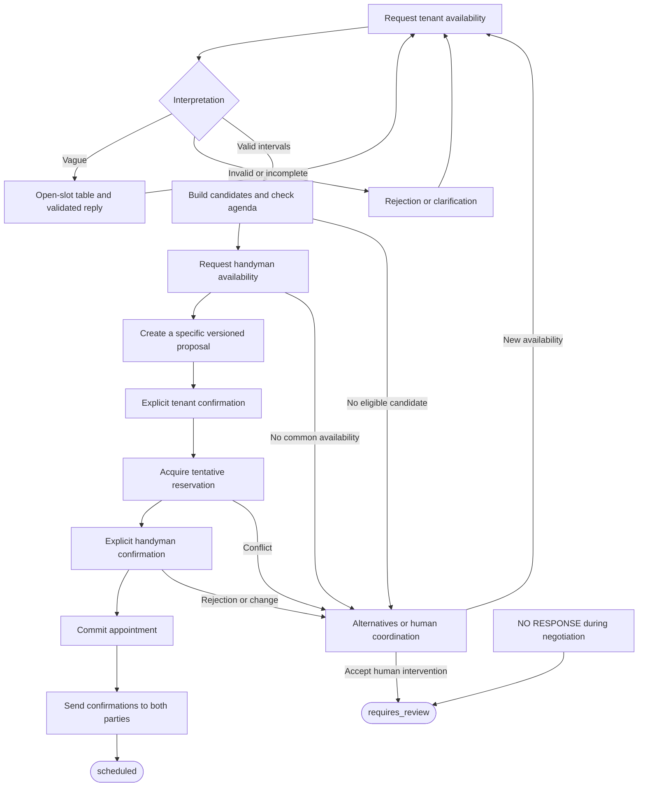
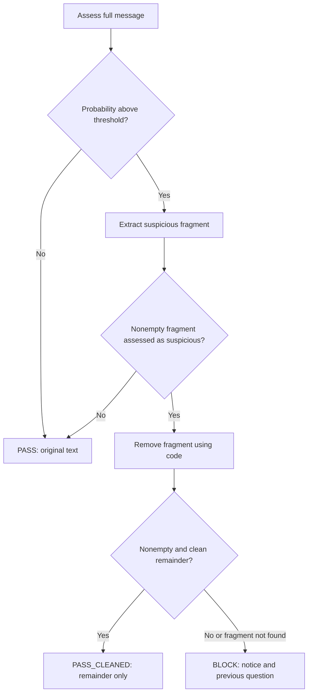

# Nuva Living — Maintenance Scheduling Agent

A CLI agent that coordinates maintenance visits between tenants and a single
handyman. It reads work orders from CSV, communicates through stdin/stdout, and
ends each negotiation with `scheduled` or `requires_review`. Visits last two
hours, use `Europe/Madrid`, and require both participants to explicitly accept
the same date and time.

## Running the agent

Docker is the evaluator's only prerequisite. Create `.env` with
`ANTHROPIC_API_KEY` (see [.env.example](.env.example)); never commit credentials.
Place `work_orders.csv` in the repository root and run:

```bash
mkdir -p traces
docker build -t agent .
docker run --env-file .env -i \
  -v "$(pwd)/work_orders.csv:/app/work_orders.csv:ro" \
  -v "$(pwd)/traces:/app/traces" \
  agent
```

Dependencies and development tools are declared in [pyproject.toml](pyproject.toml).
The container uses `uv.lock` to install reproducible versions. Settings are read
at startup; changing them requires a restart. Language recognition and
conversation models can be configured separately. Without credentials, the
fallback requests clarification instead of interpreting availability through
Anthropic.

## Communication protocol

The read-only CSV contains these columns. The repository's current sample has
one Critical work order in English and one High work order in Spanish:

```csv
work_order_id,work_order,address,description,reported_at,urgency
WO-001,Gas leak - 24 Oak Street,24 Oak Street,Tenant reports a strong smell of gas in the kitchen,2026-10-07T09:15:00+02:00,Critical
WO-002,Fuga de agua - Calle Mayor 18,Calle Mayor 18,El inquilino informa de una fuga de agua debajo del fregadero,2026-10-07T10:40:00+02:00,High
```

Incoming messages identify the work order and sender:

```text
WO-001|tenant I am available on 14 October 2026 from 16:00 to 18:00, Madrid time.
WO-002|tenant <NO RESPONSE>
```

Outgoing messages identify the recipient and end with a blank line:

```text
WOID:WO-001|ROLE:handyman
¿Puedes realizar la visita el 14 de octubre de 2026 de 16:00 a 18:00, hora de Madrid?

```

The terminal result formats are:

```text
WOID:WO-001|RESULT:scheduled
SCHEDULED_FOR:2026-10-14T16:00:00+02:00

WOID:WO-002|RESULT:requires_review
REASON:Unable to establish a mutually acceptable visit time.
```

These protocol examples illustrate the format. The handyman receives Spanish
messages; the tenant's language is inferred from the work-order description.
The console is reserved for the protocol; technical logs go to files.

## Architecture and actual graph

The stack is Python 3.12, LangGraph, Anthropic, Pydantic, and
`dependency-injector`. The domain holds business rules; the application manages
negotiation and the shared agenda; infrastructure implements CSV, CLI, model
calls, and traces. Dependencies are assembled once at startup.

`AsyncCoordinator` starts all orders concurrently and retains a separate state
for each. A FIFO queue serializes events within each conversation. Different
orders progress concurrently against a single shared scheduling authority.

The compiled graph in [graph.py](src/maintenance_agent/agents/scheduling/graph.py)
executes **one transition per invocation**. With the security guard enabled, its
actual nodes and routing are:


`END` finishes that invocation. The coordinator delivers output, saves state,
and invokes the graph again for the next event. Without the guard, `START`
connects directly to `negotiation_transition`. The transition recognizes the
language once and dispatches startup, incoming messages, displaced reservations,
or continuation of final confirmations to the workflow.

## Negotiation workflow

The following phases run inside
[NegotiationWorkflow](src/maintenance_agent/application/workflow.py); they are
internal workflow steps rather than separate compiled graph nodes:



Availability creates candidates. Explicit acceptances refer to a specific
proposal ID and version. The tenant's acceptance triggers a reservation attempt;
the handyman's acceptance commits the appointment. Both participants receive
confirmation before the terminal result is emitted.

Agenda operations are atomic. A tentative reservation may be displaced by a
higher-urgency order (`Critical > High > Medium > Low`); confirmed appointments
are never displaced. The affected order receives an event to negotiate an
alternative. Priority is enforced when reservations are acquired: merely
offering a free slot does not reserve it.

Ambiguous replies prompt clarification. Availability changes are confirmed
before replacing earlier evidence. The exact body `<NO RESPONSE>` ends the
negotiation with `requires_review`, without real-time waiting. The workflow
stops advancing orders that already have a terminal status.

## Evaluators and validation

| Component | What it checks | Effect |
|---|---|---|
| LLM language recognizer | Work-order description language | Sets the tenant language; undetermined language uses bilingual text. |
| LLM availability interpreter | Intervals, mentioned dates, ambiguity, and vague requests | Returns typed evidence for validation. |
| LLM prompt-injection classifier | Message, suspicious fragment, and remainder | Supplies evidence for deterministic pass, clean, or block decisions. |
| LLM slot-reply validator | Language, clarity, invented dates, and technician availability claims | Accepts a draft or supplies regeneration feedback. |
| Deterministic validators | Inputs, dates, intervals, conflicts, and consent | Control accepted evidence and reservations. |

### Prompt-injection guard

The guard runs before message interpretation and is connected when Anthropic
credentials exist. The exact `<NO RESPONSE>` sentinel bypasses model screening.
The classifier returns `answer` and `probability_yes`; code applies
`probability_yes > INJECTION_THRESHOLD`, defaulting to `0.6`. This is a
self-reported model estimate, not a calibrated probability.



Screening uses up to three assessments plus one extraction call. Code removes
the fragment so the model does not rewrite the participant's message. A blocked
message does not advance negotiation or enter conversation history. Assessments
are traced. Provider errors make the guard fail open: the message continues,
the error is recorded, and downstream validation remains active.

### Slot-reply composer and evaluator

For vague requests, code builds an open-slot table from an agenda snapshot. The
LLM produces only an introduction and closing request. Code inserts the table
and the disclaimer that an open agenda slot does not establish handyman
availability.

Before delivery, deterministic checks require intact table content, both prose
sections, no internal identifiers, and an agenda that still matches the table.
A separate LLM call checks the language, the request for concrete dates, and
whether the prose invents times or promises technician availability.

Feedback is supplied to the next composition attempt, up to three attempts.
Malformed verdicts and provider errors count as failures. After exhaustion,
code sends a deterministic reply with the table and a clarification request.
This evaluator applies to slot suggestions; ordinary messages do not all pass
through an LLM evaluator.

### Tools and deterministic rules

The availability interpreter has tools for calendar calculations, visit end
times, date ranges, ambiguous hours, date validation, and reading specialized
instructions. Pydantic and domain code validate its output.

Default visits are within 09:00–19:00 and the planning horizon ends at today plus
seven days, inclusive. Validation rejects nonexistent dates, impossible times,
past dates, dates outside the horizon, and weekday/date mismatches. Relative
dates use the execution clock, not `reported_at`. Explicit yes/no decisions are
interpreted by code.

Empty messages, oversized bodies (default: more than 2000 characters), and
unknown work orders receive fixed responses. The coordinator also replaces a
primary outgoing message if it contains internal identifiers such as `SLOT-…`.

## Traces and evaluation

Each execution creates `/app/traces/runs/<timestamp>-<run_id>/`:

- `manifest.jsonl`: execution start, finish, and context.
- `events.jsonl`: messages, evidence, transitions, and decisions.
- `runtime.jsonl`: technical incidents and provider errors.

Events contain `timestamp`, `run_id`, `sequence`, `work_order_id`, `event_type`,
and `detail`. Filter `events.jsonl` by order and follow its sequence to
reconstruct a conversation. A complete live run using the current repository CSV
and Anthropic is included in
[`examples/complete-run/runs/20261012T233227+02:00-657314e2/`](examples/complete-run/runs/20261012T233227+02:00-657314e2/).
It contains the CSV, JSONL traces, and a trace-derived `conversation.txt` with
`IN`/`OUT` labels:

| Work order | Outcome | Detail |
|---|---|---|
| WO-001 | `scheduled` | 2026-10-13, 16:00–18:00, Madrid time; both participants explicitly accepted. |
| WO-002 | `requires_review` | The tenant sent the exact `<NO RESPONSE>` sentinel. |

The run was started in the background with
`uv run --no-sync maintenance-agent --csv ./work_orders.csv` and closed through
stdin EOF after both results. The initial messages were emitted for both orders
before any participant replied. A separate offline timeout example is in
[`examples/complete-run/runs/20261012T233621+02:00-c72baec0/`](examples/complete-run/runs/20261012T233621+02:00-c72baec0/);
both orders receive `<NO RESPONSE>` and end as `requires_review`.

The verified Docker smoke run, including input, output, and JSONL traces, is in
[`examples/docker-run/`](examples/docker-run/). On 2026-10-12,
`docker build -t agent .` succeeded and the container run exited successfully
with empty stderr. With Anthropic configured, it recognized the English and
Spanish order descriptions; both inputs then timed out and produced exactly one
`requires_review` result each. This confirms startup, protocol, and trace
behavior, but does not exercise a scheduled negotiation in Docker.

Development dependencies and test configuration are defined in
[pyproject.toml](pyproject.toml). Run the local suite with:

```bash
uv run pytest
```

The [live evaluator](integration_test/README.md) runs scripted conversations
against the real application and Anthropic:

```bash
uv run python integration_test/run.py --list
uv run python integration_test/run.py dates_calendar
uv run python integration_test/run.py --all -j 4
```

Its checks are code predicates over messages and trace events, evaluated after
each step and across the scenario. Coverage includes dates, ambiguity, consent,
injection, priority, formats, roles, and availability changes. Results include
`PASS`, `FAIL`, `XFAIL`, `XPASS`, and timeouts. A fixed business clock makes dates
reproducible; runner timeouts supervise the test process rather than simulate
participant silence. Live scenarios consume API calls and are separate from
`uv run pytest`.

## Trade-offs and limitations

Conversation state and the agenda are in memory: restarting loses them.
LangGraph keeps each event transition small; the workflow holds the negotiation
state machine. Deterministic rules constrain model decisions, while language
interpretation and security classification can still be wrong. Extra evaluation
calls increase latency and API usage.

The input protocol has no proposal correlation field, so an ambiguous delayed
reply requires clarification. The process reads stdin until EOF, even after all
orders close. The slot table reports agenda occupancy without guaranteeing
human availability or extending the planning horizon.

Further details: [architecture](TECHNICAL_ARCHITECTURE.md),
[business rules](BUSINESS_RULES.md), [implementation](docs/IMPLEMENTATION.md),
[configuration](docs/configuration.md), and [development](docs/development.md).
