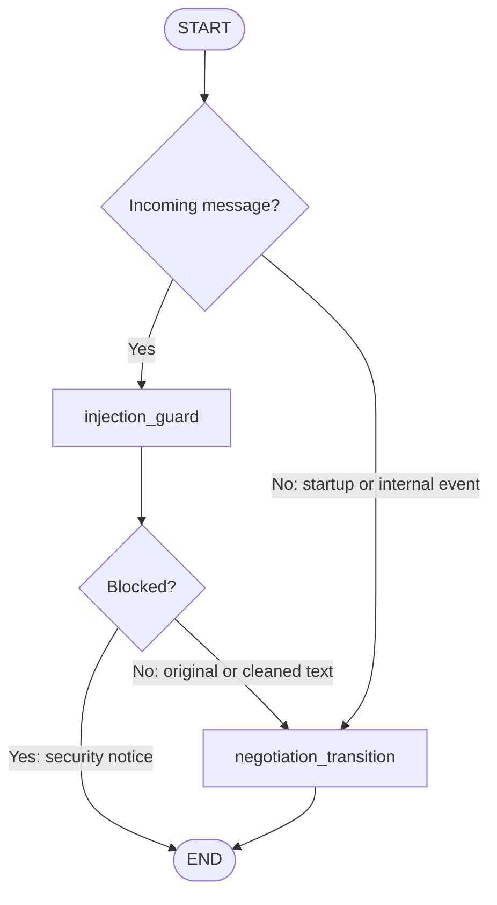
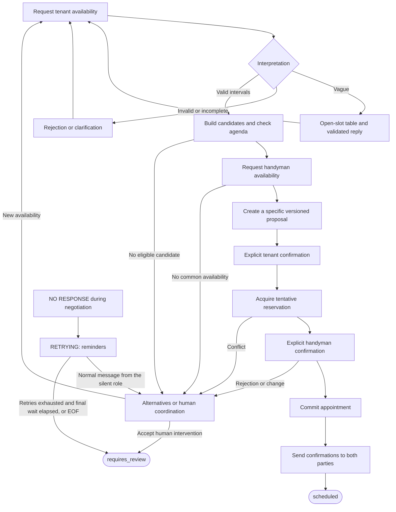
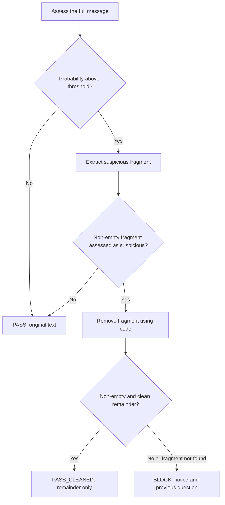

# Architecture and negotiation flow

Architecture reference. For a summary, see the [README](../README.md).

## Stack

Python 3.12, LangGraph, Anthropic, Pydantic, and `dependency-injector`. The domain holds the business rules; the application layer manages negotiation and the shared agenda; the infrastructure implements CSV, CLI, model calls, and traces. Dependencies are assembled once at startup.

## Concurrency

`AsyncCoordinator` starts all work orders concurrently and keeps a separate state for each one. A FIFO queue serializes events within each conversation. Different orders progress in parallel against a single shared scheduling authority.

## Compiled graph

The compiled graph in [graph.py](../src/maintenance_agent/agents/scheduling/graph.py) executes **one transition per invocation**. With the security guard enabled, its actual nodes and routing are:

`END` finishes that invocation. The coordinator delivers the output, saves the state, and invokes the graph again for the next event. Without the guard, `START` connects directly to `negotiation_transition`. The transition detects the language once and dispatches startup, incoming messages, displaced reservations, or continuation of final confirmations to the workflow.

## Negotiation flow

The following phases run inside [NegotiationWorkflow](../src/maintenance_agent/application/workflow.py). They are internal workflow steps, not separate nodes of the compiled graph:

Availability creates candidates. Explicit acceptances refer to a specific proposal ID and version. The tenant's acceptance triggers a reservation attempt; the handyman's acceptance commits the appointment. Both participants receive confirmation before the final result is emitted.

Agenda operations are atomic. A tentative reservation can be displaced by a higher-urgency order (`Critical > High > Medium > Low`); confirmed appointments are never displaced. The affected order receives an event to negotiate an alternative. Priority is applied when reservations are acquired: offering a free slot does not reserve it.

Ambiguous replies trigger a clarification. Availability changes are confirmed before replacing earlier evidence.

### Participant silence (`<NO RESPONSE>`)

The exact text `<NO RESPONSE>` closes the order immediately as `requires_review` by default.

If `no_response_retries_enabled` is `true` in [business_rules.json](../config/business_rules.json) (default `false`), the order moves to `RETRYING`:

- The silent role receives a fixed reminder followed by the original message every `NO_RESPONSE_RETRY_WAIT_SECONDS` (300 s by default).
- At most `NO_RESPONSE_MAX_RETRIES` (3 by default) times.
- After one more wait without an answer, the order ends as `requires_review`.
- A normal message from the silent role cancels the retries; a repeated sentinel is ignored.
- At stdin EOF, orders still retrying close immediately.
- The three timing settings are startup environment variables with defaults, so the app runs without a `.env`.
- The workflow stops advancing orders that already have a final status.

> **Compliance note:** the retry wait uses the real UTC clock. The assignment asks not to use real-time waiting or wall-clock timeouts. With the default (`false`) this does not apply; if enabled, it does not comply. See [decisions](decisions-tradeoffs.md).

## Evaluators and validation

| Component | What it checks | Effect |
|---|---|---|
| LLM language recognizer | Language of the work-order description | Sets the tenant language; an undetermined language uses bilingual text. |
| LLM availability interpreter | Intervals, mentioned dates, ambiguity, and vague requests | Returns typed evidence for validation. |
| LLM prompt-injection classifier | Message, suspicious fragment, and remainder | Supplies evidence for the deterministic pass, clean, or block decisions. |
| LLM slot-reply validator | Language, clarity, invented dates, and claims about handyman availability | Accepts a draft or supplies feedback for regeneration. |
| Deterministic validators | Inputs, dates, intervals, conflicts, and consent | Control the accepted evidence and reservations. |

### Prompt-injection guard

The guard runs before the message is interpreted and is connected when Anthropic credentials exist. The exact `<NO RESPONSE>` sentinel skips model screening. The classifier returns `answer` and `probability_yes`; the code applies `probability_yes > INJECTION_THRESHOLD`, default `0.6`. This is a self-reported model estimate, not a calibrated probability.

Screening uses up to three assessments plus one extraction call. The code removes the fragment so the model does not rewrite the participant's message. A blocked message does not advance the negotiation or enter the conversation history. Assessments are recorded in the trace. Provider errors make the guard fail open: the message continues, the error is recorded, and downstream validation stays active.

### Slot-reply composer and evaluator

For vague requests, the code builds an open-slot table from a snapshot of the agenda. The LLM produces only an introduction and a closing request. The code inserts the table and the notice that an open agenda slot does not establish handyman availability.

Before delivery, deterministic checks require the table content to be intact, both prose sections to exist, no internal identifiers, and the agenda to still match the table. A separate LLM call checks the language, the request for concrete dates, and whether the prose invents times or promises technician availability.

Feedback goes to the next composition attempt, up to three attempts. Malformed verdicts and provider errors count as failures. After the attempts are exhausted, the code sends a deterministic reply with the table and a clarification request. This evaluator applies to slot suggestions; not every ordinary message goes through an LLM evaluator.

### Tools and deterministic rules

The availability interpreter has tools for calendar calculations, visit end times, date ranges, ambiguous hours, date validation, and reading specialized instructions. Pydantic and the domain code validate its output.

Default visits are within 09:00–19:00, and the planning horizon ends at today plus seven days, inclusive. Validation rejects nonexistent dates, impossible times, past dates, dates outside the horizon, and weekday/date mismatches. Relative dates use the execution clock, not `reported_at`. Explicit yes/no decisions are interpreted by code.

Empty messages, oversized bodies (default: more than 2000 characters), and unknown work orders get fixed replies. The coordinator also replaces a primary outgoing message if it contains internal identifiers such as `SLOT-…`.

## More information

- [Configuration](configuration.md)
- [Development](development.md)
- [Technical architecture](TECHNICAL_ARCHITECTURE.md)
