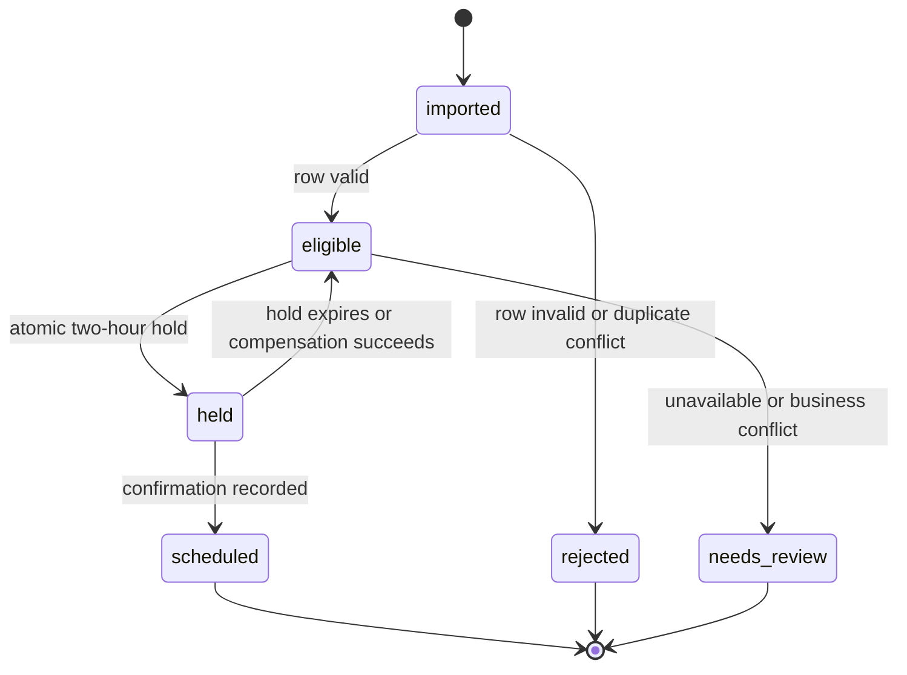

# Data Model: Async Work-Order Scheduling

## Tenant

| Field | Rules |
|---|---|
| `id` | Immutable primary identifier. |
| `name` | Display name. |
| `status` | Active tenants can submit and view WOs. |

Every tenant-scoped table has `tenant_id`; repositories require that scope for reads and writes.

## ImportJob

| Field | Rules |
|---|---|
| `id` | Immutable job identifier and graph run reference. |
| `submitted_by` | Authorized operations identity. |
| `source_file_reference` | Object reference, never the raw CSV in logs. |
| `status` | `queued`, `running`, `completed`, `completed_with_errors`, `failed`. |
| `accepted_rows`, `rejected_rows` | Final counters. |

## WorkOrder

| Field | Rules |
|---|---|
| `id` | Internal immutable identifier. |
| `tenant_id` | Required tenant scope. |
| `source_work_order_id` | Unique with `tenant_id`. |
| `priority` | `critical`, `high`, `normal`, or `low`. |
| `submission_sequence` | Monotonic sequence used after priority. |
| `requested_start_utc` | Valid future UTC instant. |
| `contact_destination` | Tenant-approved delivery destination; redact in logs. |
| `status` | `imported`, `eligible`, `held`, `scheduled`, `needs_review`, `rejected`. |
| `outcome_reason` | Controlled code and user-safe detail. |

## Handyman

Exactly one active record exists in the first release. Its identifier is required on every hold
and appointment.

## AppointmentHold and Appointment

Both use `handyman_id`, `work_order_id`, `starts_at_utc`, `ends_at_utc`, and an idempotency key.
`ends_at_utc` is always `starts_at_utc + 2 hours`. A hold has an expiration time; a confirmed
appointment does not. The database rejects an overlapping time range for the same handyman
across unexpired holds and confirmed appointments.

## WorkflowRun and TransitionEvent

`WorkflowRun` maps a LangGraph thread to an import job or WO and stores state schema version and
terminal outcome. `TransitionEvent` appends node name, timestamp, result category, redacted
metadata, tenant ID, WO ID, and correlation ID. It never stores secrets or unredacted prompts.

## State Transitions

