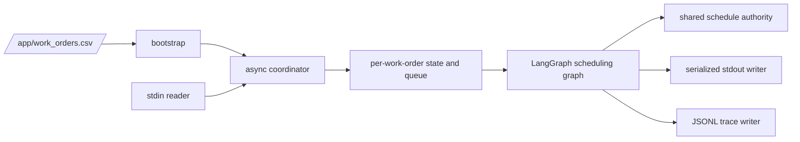

# Implementation Plan: CLI Work-Order Coordination

**Branch**: `develop` | **Date**: 2026-10-12 | **Spec**: [spec.md](spec.md)
**Sources**: [BUSINESS_RULES.md](../../BUSINESS_RULES.md) and
[TECHNICAL_ARCHITECTURE.md](../../TECHNICAL_ARCHITECTURE.md)

## Summary

Build a Docker CLI that reads the mounted CSV once, begins coordination for every valid work
order, receives messages through stdin, and emits only the required terminal protocol on stdout.
Each order has isolated LangGraph state and event ordering; a shared in-memory schedule authority
prevents overlapping two-hour visits during one process run. JSONL traces are written under
`/app/traces`.

## Technical Context

**Language/Version**: Python 3.12
**Primary Dependencies**: LangGraph, Pydantic v2, pydantic-settings, dependency-injector,
Anthropic SDK
**Storage**: In-memory coordination and schedule state; JSONL files under `/app/traces`
**Testing**: pytest, pytest-asyncio, strict type checking, Ruff, Docker protocol validation
**Target Platform**: Docker CLI with stdin/stdout
**Project Type**: Single-process asynchronous command-line application
**Constraints**: No API, database, Redis, web service, real-time human timeout, or console logs
**Scale/Scope**: Five to eight active work orders, one handyman, two-hour visits

## Constitution Check

- [x] `BUSINESS_RULES.md` is the exclusive functional authority.
- [x] `TECHNICAL_ARCHITECTURE.md` defines CLI/Docker, injection, typed state, and observability.
- [x] The plan has no unapproved external service or business-policy assumption.
- [x] `ANTHROPIC_API_KEY` is startup-only, injected, redacted, and not scheduling authority.
- [x] Every topology change will receive an approved Mermaid view and, when available, PNG.

## Project Structure

```text
src/maintenance_agent/
├── __main__.py
├── bootstrap.py
├── config.py
├── dependencies.py
├── domain/
├── application/
├── agents/scheduling/
│   ├── graph.py
│   ├── state.py
│   ├── nodes/
│   └── routers/
├── prompts/
└── infrastructure/

tests/{unit,integration,acceptance}/
docs/{decisions,graphs}/
```

## Runtime Architecture



`bootstrap.py` initializes settings and shared resources once. The coordinator processes events
sequentially inside each order while allowing distinct orders to progress concurrently. The
schedule authority owns the atomic overlap check and consolidation; no lock spans an LLM call or
human wait. The graph and all infrastructure dependencies are injected explicitly.

## Initial Graph Topology

| Node | Responsibility |
|---|---|
| `initialize_coordination` | Create initial state and issue the first required message. |
| `interpret_message` | Validate and interpret an incoming participant message. |
| `request_clarification` | Request a concrete, unambiguous fact when required. |
| `propose_visit` | Build a candidate two-hour visit from validated facts. |
| `record_acceptance` | Store evidence tied to the active proposal version. |
| `resolve_conflict` | Revalidate known competition through the shared schedule authority. |
| `confirm_visit` | Send both confirmations before a scheduled terminal result. |
| `finalize_review` | Emit an idempotent `requires_review` terminal result. |

The detailed routes are added one approved topology change at a time. Nodes cannot invent
availability or acceptance, nor emit output after their work order has closed.

## Approved Constraints and Pending Policies

The implementation must enforce explicit matching acceptance, the two-hour non-overlap invariant,
the prescribed CLI framing, clean terminal, and JSONL traces. The following require separate
approval before code assigns behavior: tenant-language inference; relative-date reference;
repeated `<NO RESPONSE>` and clarification budgets; priority tie-breaks and late competition;
invalid or duplicate CSV data; malformed/unknown input; EOF; terminal separator; and DST
semantics.

## Verification Strategy

Test pure domain rules, Pydantic contracts, dependency replacement, no import-time I/O, one state
queue per order, concurrent receipt, serialized output blocks, acceptance-version matching,
schedule races, idempotent closing, JSONL validity/redaction, and Docker execution. Report fake
LLM tests, Docker tests, and real Anthropic calls separately.
