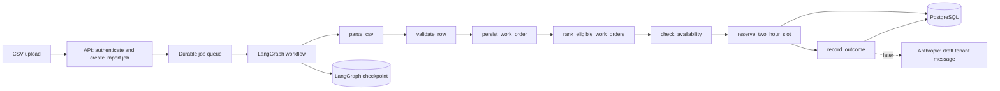

# Implementation Plan: Async Work-Order Scheduling

**Branch**: `develop` | **Date**: 2026-10-12 | **Spec**: [spec.md](spec.md)
**Input**: Feature specification from `specs/001-async-work-order-scheduling/spec.md`

## Summary

Build the first durable asynchronous workflow for CSV work orders from multiple tenants. It
imports and validates rows, persists tenant-scoped WOs, orders eligible WOs by priority and
submission sequence, then atomically reserves a two-hour appointment for one handyman. The
first graph contains only deterministic nodes; Anthropic is configured at the application edge
for later nodes and has no authority over scheduling.

## Technical Context

**Language/Version**: Python 3.12
**Primary Dependencies**: FastAPI, LangGraph, Pydantic, SQLAlchemy async, Anthropic SDK
**Storage**: PostgreSQL for domain records, idempotency records, and LangGraph checkpoints
**Testing**: pytest, pytest-asyncio, HTTP integration tests, PostgreSQL-backed concurrency tests
**Target Platform**: Linux container service
**Project Type**: Web service with asynchronous workers
**Performance Goals**: Record a result for 1,000 CSV rows within five minutes; preserve the
capacity-one invariant under concurrent scheduling attempts
**Constraints**: UTC persistence; all services last exactly two hours; a missing
`ANTHROPIC_API_KEY` only blocks nodes that use Anthropic; tenant scope and appointment conflicts
are deterministic database-enforced rules
**Scale/Scope**: One handyman, several tenants, one requested service window per WO in the first
slice

## Constitution Check

*GATE: Passed before Phase 0 research. Re-checked after Phase 1 design.*

- [x] Tenant identifiers are authenticated at the boundary, propagated through job payload,
      LangGraph state, tables, queries, and audit events.
- [x] The reservation transaction locks the handyman's booking window and rejects every overlap
      before a hold or appointment can be committed.
- [x] Named LangGraph nodes use a typed, versioned state and durable checkpointing; their error
      and retry paths are documented below.
- [x] The first slice is independently verifiable through import, prioritization, and concurrent
      overlap acceptance tests.
- [x] Anthropic is runtime-configured through `ANTHROPIC_API_KEY`; no initial node calls it, and
      future calls can propose text only after deterministic scheduling succeeds.
- [x] New work starts in `feature/<feature-name>` from `develop` and merges back only after
      tests pass.

## Branch Workflow

**Working Branch**: `develop`
**Integration Branch**: `develop`
**Merge Gate**: Tenant-isolation, two-hour no-overlap, idempotency, and changed graph-branch
tests must pass before merge to `develop`.

For a later change to this completed work, first ask whether it is a defect or intended behavior.
A defect starts as `fix/<issue-name>` from current `develop`; intended behavior starts as
`feature/<feature-name>` from current `develop`. Do not reopen this old branch by default.

## Project Structure

### Documentation (this feature)

```text
specs/001-async-work-order-scheduling/
├── plan.md
├── research.md
├── data-model.md
├── quickstart.md
├── contracts/
│   └── http-api.md
└── checklists/
    └── requirements.md
```

### Source Code (repository root)

```text
app/
├── api/                 # HTTP boundary and authenticated tenant context
├── domain/              # WOs, appointment rules, prioritization, domain errors
├── persistence/         # SQLAlchemy models, repositories, transactions, migrations
├── workflows/           # Typed state, LangGraph builder, individual nodes
├── workers/             # Asynchronous job submission and execution
├── integrations/        # CSV reader and later Anthropic adapter
└── observability/       # Structured logging and workflow audit events

tests/
├── unit/
├── integration/
└── acceptance/
```

**Structure Decision**: A single Python service keeps the transaction that owns capacity and the
workflow that requests it close together. The API submits durable jobs; workers invoke the graph
asynchronously. A later scaling decision may separate workers, without changing the domain
transaction or graph contract.

## Architecture



The graph is an orchestrator, not the source of scheduling truth. `reserve_two_hour_slot` calls
one transactional domain operation. That operation obtains the authoritative lock and inserts a
hold or appointment only when the full two-hour window is conflict-free. A graph retry therefore
cannot create a second booking: it presents the same idempotency key to the transaction.

### Initial Graph State

`WorkOrderSchedulingState` carries: `schema_version`, `run_id`, `import_job_id`, `row_number`,
`tenant_id`, `work_order_id`, `source_work_order_id`, `priority`, `submitted_at`,
`requested_start_utc`, `appointment_id`, `idempotency_key`, `current_status`, `error_code`, and
`transition_events`. It contains raw values only; it never contains an API key or formatted AI
prompt. Every node returns a typed partial update and appends one redacted transition event.

### Initial Nodes and Transitions

| Node | Responsibility | Success transition | Recoverable transition | Terminal transition |
|---|---|---|---|---|
| `parse_csv` | Stream rows and assign row metadata. | `validate_row` | retry import read | `record_outcome` for unreadable file |
| `validate_row` | Validate required fields, UTC window, priority, and tenant context. | `persist_work_order` | none | `record_outcome` as rejected |
| `persist_work_order` | Idempotently store WO and its import result. | `rank_eligible_work_orders` | retry database fault | `record_outcome` |
| `rank_eligible_work_orders` | Choose next eligible WO by priority and submission sequence. | `check_availability` | none | `record_outcome` if no eligible WO |
| `check_availability` | Ask deterministic domain rule if requested 2-hour slot is feasible. | `reserve_two_hour_slot` | retry database fault | `record_outcome` as needs review |
| `reserve_two_hour_slot` | Execute atomic hold/appointment transaction. | `record_outcome` | retry transient transaction fault with same key | `record_outcome` as conflict/review |
| `record_outcome` | Persist outcome and audit transition. | `END` | retry database fault | `END` with failure recorded |

Future nodes are added after `record_outcome` or through an explicit review branch: alternative
slot selection, tenant notification drafting with Anthropic, human approval, and notification
delivery. They cannot bypass validation or reservation.

## Complexity Tracking

| Violation | Why Needed | Simpler Alternative Rejected Because |
|---|---|---|
| Durable queue plus graph checkpoints | Imports and bookings continue after a worker restart. | In-process background tasks lose work and cannot safely resume. |
| PostgreSQL exclusion constraint and transaction | Capacity-one appointments must remain conflict-free under concurrency. | An application-only availability check races under concurrent requests. |
