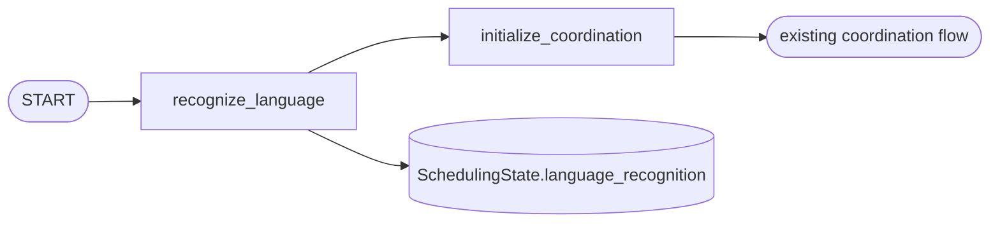

# Validation Results: Infer Work-Order Language

**Feature**: `003-infer-order-language`
**Branch**: `003-infer-order-language`
**Date**: 2026-10-12
**Scope**: T018 + T019 from `specs/003-infer-order-language/tasks.md`

## Ruff

```bash
UV_CACHE_DIR=/tmp/uv-cache uv run ruff check src tests
```

Result:

```
All checks passed!
```

## Pytest (focused)

```bash
UV_CACHE_DIR=/tmp/uv-cache uv run pytest \
  tests/unit/test_languages.py \
  tests/unit/test_language_recognition_node.py \
  tests/unit/test_language_prompt.py \
  tests/unit/test_anthropic_language_recognizer.py \
  tests/integration/test_scheduling_graph.py -v
```

Result: **14 passed in 1.31s**

| Test | Module | Status |
|---|---|---|
| test_catalogue_contains_required_common_iso_codes | tests/unit/test_languages.py | passed |
| test_unknown_provider_value_becomes_undetermined | tests/unit/test_languages.py | passed |
| test_node_adds_validated_language_result_to_state | tests/unit/test_language_recognition_node.py | passed |
| test_node_preserves_undetermined_result | tests/unit/test_language_recognition_node.py | passed |
| test_prompt_is_english_and_lists_allowed_values | tests/unit/test_language_prompt.py | passed |
| test_recognizer_validates_provider_language_code | tests/unit/test_anthropic_language_recognizer.py | passed |
| test_recognizer_maps_invalid_provider_output_to_undetermined | tests/unit/test_anthropic_language_recognizer.py | passed |
| test_recognizer_skips_provider_for_blank_description | tests/unit/test_anthropic_language_recognizer.py | passed |
| test_graph_recognizes_language_before_initial_message | tests/integration/test_scheduling_graph.py | passed |
| test_graph_retains_undetermined_result | tests/integration/test_scheduling_graph.py | passed |
| test_graph_recognizes_english_before_initial_message | tests/integration/test_scheduling_graph.py | passed |
| test_coordinator_starts_each_work_order_then_reflects_live_message | tests/integration/test_async_coordination.py | passed |
| test_csv_reader_normalizes_all_rows_to_injected_timezone | tests/integration/test_async_coordination.py | passed |
| test_coordinator_logs_recognized_language_per_work_order | tests/integration/test_async_coordination.py | passed |

## Graph topology vs. diagram

Compiled graph (`src/maintenance_agent/agents/scheduling/graph.py`):

```
START -> recognize_language -> initialize_coordination -> END
```

Mermaid source (`docs/graphs/003-language-inference-flow.mmd`):



The diagram documents the same node order; the `RECOGNIZE --> STATE` edge represents the
`SchedulingState.language_recognition` state update returned by `RecognizeLanguageNode`, not a graph
edge. Rendered PNG: `docs/graphs/003-language-inference-flow.png` (21226 bytes), generated locally
with `mmdc` driving the cached Playwright Chromium 1223.

## Real-provider smoke

Not executed in this validation run. Per `quickstart.md`, a real-provider smoke run requires a
developer-approved non-production `ANTHROPIC_API_KEY` and is reported separately from these
fake-provider focused tests.

## Language-recognition logging

`AsyncCoordinator._start` emits one INFO record per work order through the
`maintenance_agent.coordinator` logger:

```
2026-10-12 14:45:01,123 INFO maintenance_agent.coordinator language_recognition work_order_id=WO-4 language=es
```

Logging is configured by `bootstrap._configure_logging` to stderr at INFO level and never touches
the stdout protocol stream emitted by `AsyncStdoutWriter`. No prompt, description, or credential is
included in the record.